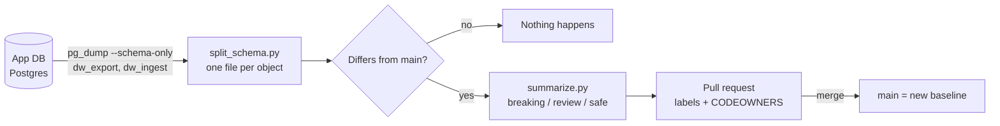

# app-dw-contracts

Tracks the two schemas that sit between the app database and the SQL Server
data warehouse, and opens a pull request whenever either one changes.

| Folder      | Schema(s)   | Direction                  | Who depends on it              |
|-------------|-------------|----------------------------|--------------------------------|
| `outbound/` | `dw_export` | app DB → data warehouse    | the warehouse pipeline reads it  |
| `inbound/`  | `dw_ingest` | data warehouse → app DB    | the warehouse pipeline writes it |

The rest of the app database isn't tracked. Changes outside these schemas never
open a PR.

## Why

Today a change to either schema is found when a pipeline run fails, or worse,
when it keeps running and loads the wrong data. With this repo:

- **Every change is visible before it bites.** Within hours of a change reaching
  the database, a PR shows exactly what changed, as DDL, one file per table.
- **The PR says whether it's dangerous.** Each change is marked 🔴 breaking,
  🟡 needs review or 🟢 safe, based on the direction. Dropping a column the
  warehouse reads is breaking. Adding a required column the warehouse must
  write is breaking. Adding an optional export column is safe.
- **The right people are pulled in.** CODEOWNERS routes `outbound/` changes to
  the warehouse team and `inbound/` changes to the app team.
- **There's a history.** `git log outbound/dw_export/tables/residents.sql` shows
  every change to that table, when it was detected, and who approved it.

See [docs/example-pr.md](docs/example-pr.md) for a full example PR.

## How it works



1. Every 6 hours, `.github/workflows/schema-snapshot.yml` runs `scripts/snapshot.sh`.
   It runs `pg_dump --schema-only` for each contract schema. It reads no data.
2. `scripts/split_schema.py` splits the dump into one file per object, with each
   table's constraints, indexes, triggers and comments in that table's file.
3. `scripts/summarize.py` compares the snapshot with `main` and writes the PR
   description.
4. If anything differs, the workflow opens a PR, or updates the open one. If the
   schema goes back to matching `main`, the PR closes itself.
5. Merging the PR acknowledges the change and makes it the new baseline.

## Try the demo

The repo ships with a fictional demo database (`demo/seed.sql`) and five change
scenarios. You don't need access to a real database.

### On GitHub (recommended for showing people)

1. Push this repo to GitHub.
2. In **Settings → Actions → General**, under "Workflow permissions", enable
   **Allow GitHub Actions to create and approve pull requests**.
3. Go to **Actions → Schema snapshot → Run workflow** and pick a scenario.
   About a minute later, a PR appears.

| Scenario                   | What it shows                                                   |
|----------------------------|-----------------------------------------------------------------|
| `1-add-column`             | A new nullable export column: 🟢 safe                           |
| `2-breaking-export-change` | A dropped column, a type change, a relaxed NOT NULL: 🔴 breaking |
| `3-new-enum-value`         | A new status value the warehouse must map: 🟡 review             |
| `4-inbound-change`         | A new feed table and a required column the warehouse must fill  |
| `5-untracked-change`       | A change outside the contract schemas: **no PR** (that's the point) |

Each scenario gets its own branch, so you can open several PRs side by side.
Close them without merging when you're done.

### On your machine

Requires Docker and Python 3.

```bash
./demo/run-local.sh 2-breaking-export-change
```

This prints the files that would change and the PR description, then restores
the repo.

## Going live

1. **Repo secret `PG_URL`**: a connection string for a **read-only** role (see
   Security notes). Once this is set, the workflow
   switches from demo to live mode.
2. **Repo variables** (Settings → Secrets and variables → Actions → Variables):
   - `OUTBOUND_SCHEMAS`, `INBOUND_SCHEMAS`: comma-separated schema names
     (defaults `dw_export`, `dw_ingest`)
   - `PG_MAJOR`: the server's major version, so `pg_dump` matches (default `16`)
   - `SNAPSHOT_RUNNER`: set to `self-hosted` if the database is on a private network
3. **Network access.** GitHub-hosted runners can't reach a database behind a
   private endpoint. Register a self-hosted runner inside the VNet (a small VM or
   a Container Apps job) and set `SNAPSHOT_RUNNER`.
4. **Baseline.** Run the workflow once and merge the first PR. It replaces the
   demo snapshot with the real schemas.
5. **CODEOWNERS.** Fill in the team handles in `.github/CODEOWNERS`.
6. Remove `demo/` once you're done showing it, if you like.

## Security notes

- Only DDL is read and stored: table and column names, types, constraints. No
  rows, so no PHI.
- The role needs `USAGE` on the contract schemas and `SELECT` on their tables.
  `pg_dump` takes a brief share lock on each table, and that needs `SELECT`, but
  with `--schema-only` it never reads a row.
- If a migration is holding a lock, the snapshot waits up to 30 seconds and then
  fails, so it never queues behind DDL. The next run picks the change up.
- `--no-owner --no-privileges` keeps role names and grants out of the repo. Drop
  `--no-privileges` in `scripts/snapshot.sh` if you want grant changes tracked too.

## Layout

```
.github/workflows/schema-snapshot.yml   scheduled job + demo mode
.github/CODEOWNERS                      who reviews which direction
scripts/snapshot.sh                     pg_dump each contract schema → split
scripts/split_schema.py                 pg_dump output → one file per object
scripts/summarize.py                    diff vs main → PR description + labels
outbound/                               current snapshot of dw_export
inbound/                                current snapshot of dw_ingest
demo/                                   seed database, scenarios, local runner
docs/example-pr.md                      what a PR looks like
```
